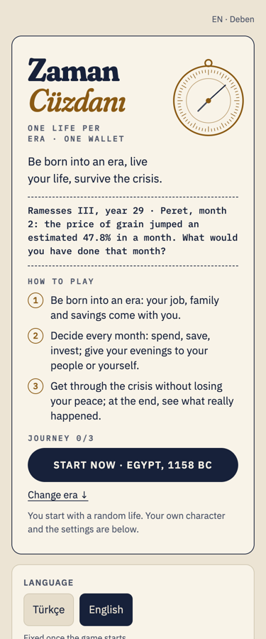
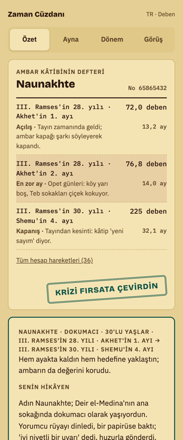

# Zaman Cüzdanı · Time Wallet

*Her çağda bir hayat · tek cüzdan — One life per era · one wallet*

**▶ Oyna / Play:** https://kurusatsu.github.io/zaman-cuzdani-oyun/

  
  

## Türkçe

Tarihin kriz anlarından birine doğarsın. Ay ay paranı, işini, yakınlarını ve huzurunu yönetirsin; sonunda kendi hikâyeni gerçekte olanla karşılaştırırsın. Ekonomi verisi dönemin kaynaklarından gelir, olaylar dönemin gerçek takvimine bağlıdır. Kayıt yok, kurulum yok; telefonda ve bilgisayarda tarayıcıda çalışır.

**Dönemler**

| Dönem | Kriz | Birikim yolları |
|---|---|---|
| Mısır, MÖ 1158 · Deir el-Medina | Ramses'in mezar işçileri: tayın gecikmesi ve grev | tahıl, gümüş, zanaat |
| 1929 · Büyük Buhran (ABD) | Borsa çöküşü, banka iflasları | banka, posta tasarrufu, altın, hisse |
| 2001 · Kur Krizi (Türkiye) | Kasım 2000 ve Şubat 2001 krizleri | mevduat, dolar, altın, borsa |

Her dönem kısa (36 ay) ya da tam (61–72 ay) oynanır. "Hemen başla" seni Mısır → 1929 → 2001 yolculuğuna sokar; istersen dönemi, karakterini ve zorluğu kendin seçersin.

**Nasıl oynanır**

1. **Bir döneme doğ:** meslek, aile ve birikim seninle gelir.
2. **Her ay karar ver:** parayı dönemin saklama yolları arasında dağıt; akşamlarını yakınlarına, kendine, yan işe ya da kursa ayır. Dönemin gerçek olayları araya girer, kararların yıllar sonra geri dönebilir.
3. **Krizi huzurunu kaybetmeden atlat:** borç elindekini aşarsa iflas, huzur biterse tükenme.

Sonunda dönemin belgesinde (banka cüzdanı, aracı kurum dökümü, ambar kâtibi defteri) hesap hareketlerini ve sonucunu görürsün. "Ayna" sekmesi, paran hep tek bir yerde dursaydı ne olacağını gösterir. "Dönem" sekmesi gerçekte ne olduğunu anlatır. Başarımlar ve serbest devam da var.

**Görünüş:** Giriş ekranı cep saati temalıdır: krem kâğıt, lacivert mürekkep, bronz. Oyunda her dönemin kendi teması vardır: Mısır'da ostrakon, 1929'da borsa şeridi, 2001'de gazete kupürü. Her temanın kendi paleti ve sahne çizimleri vardır. Telefon öncelikli düzen, açık ve koyu tema.

## English

You are born into one of history's crisis moments. Month by month you manage your money, your work, your people and your peace of mind, then compare your story with what really happened. Economic data comes from period sources, and events follow the real calendar. No sign-up, no install; it runs in the browser on phone and desktop. Available in Turkish and English.

**Eras:**

- Egypt 1158 BC (Deir el-Medina tomb workers: late rations and a strike).
- 1929 (the Great Depression in the US).
- 2001 (Turkey's currency crisis).

Each era plays short (36 months) or full (61–72 months). "Start now" takes you on the journey Egypt → 1929 → 2001.

**How to play:**

1. Be born into an era.
2. Decide every month: spend, save, invest, and spend your evenings on your people or yourself.
3. Get through the crisis without losing your peace. Debt beyond your means is bankruptcy; running out of peace is burnout.

At the end, a period document shows your ledger and verdict. The "mirror" tab shows what would have happened if your money had stayed in one place the whole time.

## Bu depo hakkında / About this repo

Bu depo yalnız oyunun derlenmiş dosyalarını barındırır ve GitHub Pages ile yayınlanır. Kaynak kod ayrı bir özel depodadır.

This repo holds only the built game and is served by GitHub Pages. The source code lives in a separate private repository.

**Teknoloji / Tech:**

- TypeScript and [Preact](https://preactjs.com/), built with [Vite](https://vite.dev/) and tested with [Vitest](https://vitest.dev/).
- Targets Safari/iOS 14+, Chrome 87+ and Firefox 78+.
- No server, no accounts and no tracking. Saves stay in the browser's `localStorage`.

**Lisanslar / Licences:**

- Fonts: Bricolage Grotesque, Fraunces, IBM Plex Sans and IBM Plex Mono (SIL OFL 1.1).
- Preact: MIT licence.
- Texts, icons and scene art were made for this game.
- Data sources are listed in the in-game "Sources" dialog.
